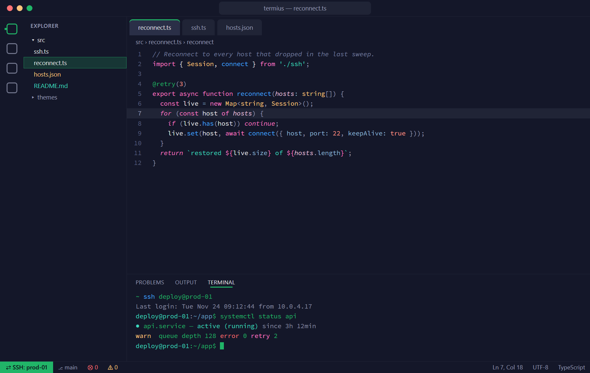
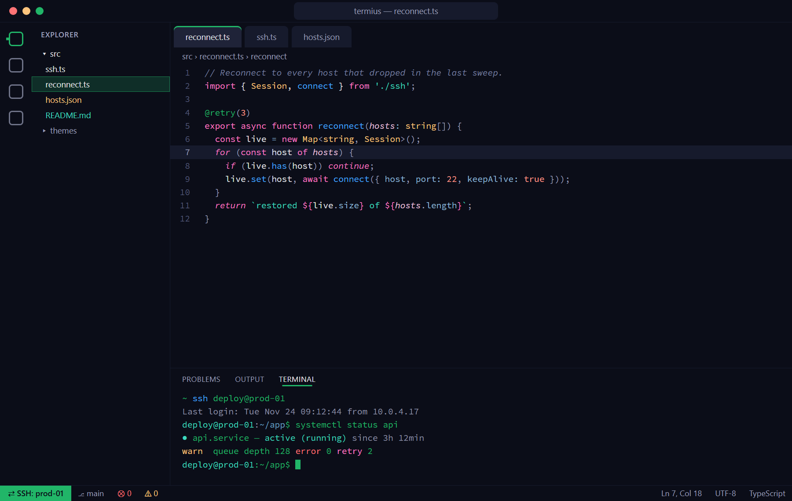
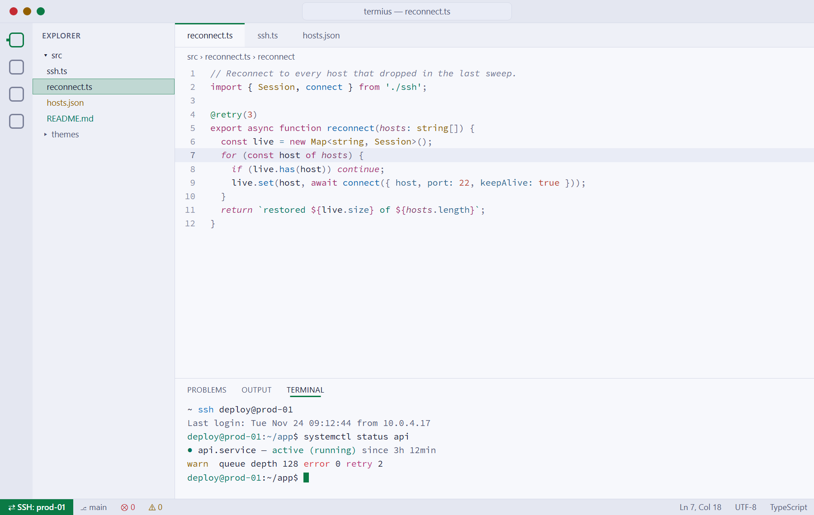

# Termius Theme

An unofficial VS Code theme in the spirit of Termius: a deep navy UI with a signal-green accent, a terminal that uses the exact **Termius Dark** palette, and syntax colours that pass WCAG contrast checks in every variant.



## Variants

| Theme | Editor background | Best for |
| --- | --- | --- |
| **Termius Dark** | `#141729` | Everyday dark theme, closest to Termius |
| **Termius Midnight** | `#0b0d18` | Dim rooms and OLED screens |
| **Termius Light** | `#f7f8fc` | Daylight, with the same navy and green character |

<details>
<summary>Midnight</summary>


</details>

<details>
<summary>Light</summary>


</details>

## Install

1. Open **Extensions** (`Ctrl+Shift+X` / `Cmd+Shift+X`) and search for **Termius Theme**.
2. Click **Install**.
3. Run **Preferences: Color Theme** (`Ctrl+K Ctrl+T`) and pick Termius Dark, Termius Midnight or Termius Light.

To install from a release instead, download the `.vsix` from [Releases](https://github.com/XakimovNosirbek/termius-theme/releases) and run:

```sh
code --install-extension termius-theme-<version>.vsix
```

## What is in it

- **Full workbench coverage.** More than 500 UI colours: editor, tabs, side bar, panels, status bar, command center, notifications, merge editor, testing, debugging, notebooks, chat and the source control graph.
- **Termius Dark terminal.** All 16 ANSI colours and the green terminal text are taken unchanged from Termius 10.4.1, so SSH sessions in VS Code look as they do in Termius.
- **Tuned syntax highlighting.** 75 TextMate rules plus semantic highlighting, with extra care for TypeScript and JavaScript, Python, Go, Rust, C#, Java, SQL, shell, CSS, HTML and JSX, JSON, YAML, TOML and Markdown.
- **Readable by design.** Every syntax colour meets WCAG AA (4.5:1) against the editor background. Comments and punctuation meet 3.5:1. The check runs in CI on every change.

## Recommended settings

```jsonc
{
  "workbench.colorTheme": "Termius Dark",
  "editor.fontFamily": "'SauceCodePro Nerd Font Mono', 'Source Code Pro', Consolas, monospace",
  "editor.fontSize": 14,
  "editor.bracketPairColorization.enabled": true,
  "terminal.integrated.fontFamily": "'SauceCodePro Nerd Font Mono', monospace",
  "terminal.integrated.cursorStyle": "block"
}
```

Source Code Pro is the font Termius uses. The Nerd Font build adds icons for shell prompts such as Starship and Powerlevel10k.

### If you used a hand-made Termius setup before

Remove `workbench.colorCustomizations` entries you added for Termius colours from your `settings.json`. They are applied on top of any theme and will hide this one.

### Turning off italics

```jsonc
"editor.tokenColorCustomizations": {
  "[Termius*]": {
    "textMateRules": [
      { "scope": ["comment", "keyword.control", "variable.parameter", "entity.other.attribute-name", "variable.language"], "settings": { "fontStyle": "" } }
    ]
  }
},
"editor.semanticTokenColorCustomizations": {
  "[Termius*]": { "rules": { "parameter": { "italic": false }, "interface": { "italic": false }, "typeParameter": { "italic": false } } }
}
```

### Terminal contrast

The original Termius dark blue (`#08639f`) is dim on navy. VS Code raises low-contrast terminal text automatically through `terminal.integrated.minimumContrastRatio`, which defaults to 4.5. Set it to `1` if you want the untouched Termius look.

## Palette

| Role | Dark | Light |
| --- | --- | --- |
| Background | `#141729` | `#f7f8fc` |
| Text | `#e2e3e8` | `#1b1f36` |
| Accent | `#21b568` | `#0b7a45` |
| Keyword | `#ff7dc5` | `#a3266c` |
| String | `#3ed7be` | `#00735c` |
| Function | `#44a7ff` | `#0a5fb0` |
| Type | `#fdc47d` | `#8a5a00` |
| Number | `#ff9b8a` | `#b8402c` |
| Comment | `#7c82a3` | `#6b7090` |

## Claude Code chat plugin

The repository also ships **termius-chat**, a Claude Code plugin that colours the Claude chat in VS Code to match: prompt cards, tool rows framed and iconed by what they do, highlighted SQL and files, and pipeline / mermaid diagrams drawn in the chat. See [claude-plugin/termius-chat](claude-plugin/termius-chat/README.md).

```
/plugin install termius-chat --marketplace XakimovNosirbek/termius-theme
```

## Development

Every theme file is generated. Edit the palette, not the JSON.

```sh
npm install
npm run build     # src/palettes.mjs + src/theme.mjs -> themes/*.json
npm run check     # generated files are current, colours are valid, contrast passes
npm run preview   # re-render images/ with headless Chrome (set CHROME=... if needed)
npm run package   # build dist/termius-theme-<version>.vsix
```

Press `F5` in VS Code to open an Extension Development Host with the theme loaded. See [CONTRIBUTING.md](CONTRIBUTING.md).

## Credits

This is an unofficial community theme. The terminal palette is taken from the Termius Dark theme; the editor and UI colours are original. Termius is a trademark of its owner, and this project is not affiliated with or endorsed by Termius.

## License

[MIT](LICENSE)
